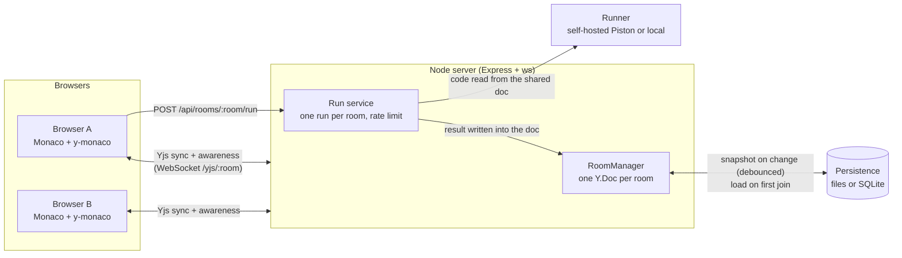

# Code Collaborator

[](https://github.com/rawatneelmayank1-sire/code-collaborator/actions/workflows/ci.yml)
[](LICENSE)

A browser code editor for pairing and interview practice. Open a room, send the link, and everyone edits the
same file at once, with live cursors and names. Edits are merged by a CRDT (Yjs), so two people typing at the
same moment never overwrite each other, and rooms keep their code when the server restarts.

<!-- Screenshot slot: save a 1440 px capture of two browsers in one room as docs/screenshot.png, then use:
 -->
*Screenshot coming soon: two browsers in one room, each with a named cursor.*

## Features

- **Conflict-free editing.** Monaco (the VS Code editor) bound to a shared Yjs document with `y-monaco`.
  Only small updates travel over the wire, never the whole file.
- **Live cursors and presence.** Every person gets a colour and a name label at their cursor; the side panel
  lists who is in the room and which line they are on.
- **Rooms that survive restarts.** The server saves each room's Yjs state (to files by default, or SQLite) and
  reloads it on the next visit.
- **Run the code.** JavaScript, Python, Java and C++ through a pluggable runner with time limits, output caps
  and a per-room rate limit. The result is written into the shared document, so everyone sees the same output.
- **Clear states.** Connecting, live, reconnecting (keep typing, edits sync later), offline, room full,
  compile error, runtime error and runner unavailable each have their own plain message.
- **Shareable links**, light and dark themes, keyboard run (`Ctrl Enter`), and a stacked layout on phones.

## Architecture



- `shared/rooms.js` holds the rules both sides use: room name and display name validation, languages, starter
  code. The browser and the server reject the same input with the same sentence.
- `server/src/rooms/yjsSocket.js` speaks the standard y-websocket protocol (sync steps, updates, awareness) on
  top of `y-protocols`, with origin checks, a room size limit, keep-alive pings and server-side name checks.
- `server/src/rooms/RoomManager.js` loads a room once (concurrent joins share the load), saves it after
  changes, and unloads it after everyone has left.
- `server/src/runner/` has the run service and three runners: `piston`, `local` and `disabled`.
- `client/src/hooks/useCollabRoom.js` owns the Yjs document and provider and turns them into React state.

## Why a CRDT

The first version sent the whole file on every keystroke and the last message won. If two people typed at
once, one person's edit disappeared and cursors jumped. A CRDT (conflict-free replicated data type) gives every
character a stable identity, so concurrent inserts and deletes from different people merge into the same result
on every machine, in any order, without a central lock. The test
`merges edits typed at the same moment by two people without losing either` in `server/test/sync.test.js`
checks exactly this.

## Quick start

Needs Node.js 22.12 or newer.

```bash
npm install
npm run dev
```

Open http://localhost:5173, pick a name, press **New room**, then **Join room**. Open the same link in a
second window to see two cursors. The server runs on port 4000; Vite proxies `/api` and `/yjs` to it.

In development the runner defaults to `local`, which runs code with the tools on your machine (Node is always
there; Python, Java and `g++` if installed). It is not a sandbox, so only use it on your own computer.

With Docker (app + self-hosted Piston runner):

```bash
docker compose up --build -d
npm run piston:install      # once: installs Node, Python, Java and GCC into Piston
```

Then open http://localhost:4000.

## Environment variables

All optional. See `.env.example`; the server reads `.env` from the project root.

| Variable | Default | What it does |
|---|---|---|
| `PORT` | `4000` | Server port |
| `HOST` | `127.0.0.1` (dev), `0.0.0.0` (production) | Interface to listen on |
| `CLIENT_ORIGIN` | empty (any) | Comma-separated origins allowed to connect |
| `PERSISTENCE` | `file` | `file`, `sqlite` (built-in `node:sqlite`) or `memory` |
| `DATA_DIR` | `server/data` | Where room snapshots are stored |
| `RUNNER` | `piston` if `PISTON_URL` is set, else `local` (dev) / `disabled` (production) | Code runner |
| `PISTON_URL` | empty | Base URL of your Piston server, for example `http://localhost:2000` |
| `RUN_TIMEOUT_MS` | `10000` | Time limit for one program |
| `RUNS_PER_MINUTE` | `10` | Runs allowed per room per minute |
| `VITE_SERVER_URL` | empty (same origin) | Client build only: server URL when the client is hosted elsewhere |

**About Piston.** The public endpoint at emkc.org has been allow-list only since 15 February 2026 (it now
answers `401`), so this project expects you to run your own Piston, which `docker-compose.yml` does. Without a
runner, Run shows "Running code is turned off on this server" instead of failing silently.

## Tests

```bash
npm test        # server and client (Vitest)
npm run lint
```

- **Server** (`server/test`): validation rules; room loading, sharing and unloading; persistence surviving a
  restart for the file, SQLite and memory adapters; path-escape protection; two real WebSocket clients merging
  concurrent edits; presence joining and leaving; invalid room names rejected with close code 4400; the run
  service (one run at a time, rate limit, input limits, runner errors turned into messages); the Piston runner
  against a fake API (compile errors, `401`, network down, hang, killed program); the local runner (stdin, exit
  codes, timeout).
- **Client** (`client/test`): join form validation and focus, people list and empty state, output panel states,
  connection status wording, and safe cursor label CSS.

GitHub Actions runs lint, tests and the build on every push and pull request, then builds the Docker image.

## Deploy notes

- One container serves the client, the API and the WebSocket: `docker build -t code-collaborator .` and run it
  with a volume on `/data` so rooms persist.
- Any host that supports WebSockets and a persistent disk works (a VM, Fly.io, Railway). On hosts without a
  persistent disk, rooms survive restarts only if you mount one or point `DATA_DIR` at it.
- Run Piston on a separate private host or container; never expose `RUNNER=local` to the internet.
- Behind a proxy, forward the `Upgrade` and `Connection` headers for `/yjs`.

## Roadmap

- Multiple files per room with a file tree.
- Room passwords and a host role (lock the editor, remove someone).
- Horizontal scaling: share rooms across server instances through Redis pub/sub.
- Chat beside the editor, and a playback of the session.
- A Playwright test that drives two browsers through a full session.

## License

MIT, see [LICENSE](LICENSE). Built by Neelmayank Rawat.
